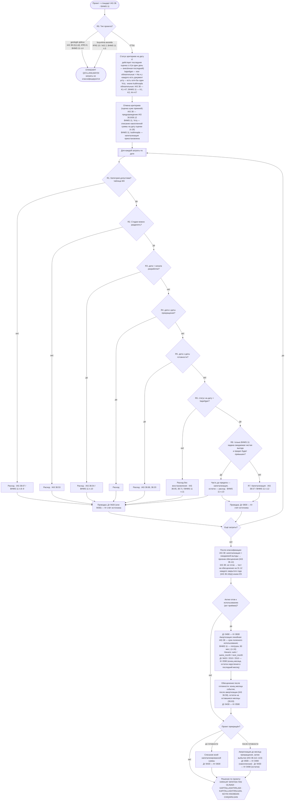

# Алгоритм движка решений ITTKI Nazorat

Реализация: `ittki/core/engine.py` (перенесён 1:1 из проверенного `reference/engine_reference.py`),
проводки: `ittki/core/journal.py`, контроль: `ittki/core/controls.py`. Движок запускается **отдельно для каждого
стандарта**: IAS 38 и BHMS 11 (2024). Результаты двух прогонов сравниваются в сверке M8.

## 1. Блок-схема (M5)

Обесценение до готовности (IAS 36.10(a), 36.59; BHMS 11 п.18): стоимость снижается до возмещаемой суммы на дату
события (Дт 9430 — Кт 0830), и амортизируется уже сниженная стоимость.

## 2. Критерии K1–K7 ↔ IAS 38 ↔ BHMS 11 (M3)

| Ключ | Критерий (uz) | IAS 38 | BHMS 11 (2024) | Обязателен: IAS 38 / BHMS 11 |
|---|---|---|---|---|
| K1 | Texnik jihatdan amalga oshirish mumkinligi | 38.57(a) | п.12, 2 | да / да |
| K2 | Yakunlash va foydalanish/sotish niyati | 38.57(b) | п.12, 3 | да / да |
| K3 | Foydalanish yoki sotish qobiliyati | 38.57(c) | — (отдельного критерия нет) | да / **нет** |
| K4 | Kelajakdagi iqtisodiy naf / bozor mavjudligi | 38.57(d) | п.12, 4 | да / да |
| K5 | Yetarli texnik, moliyaviy va boshqa resurslar | 38.57(e) | п.12, 5 | да / да |
| K6 | Xarajatlarni ishonchli o'lchash | 38.57(f) | п.12, 1 | да / да |
| K7 | Mahsulot/jarayon aniq belgilangan (identifikatsiya) | 38.12 | п.12, 1 | да / да |

Ответ `Ha` засчитывается только при наличии документа-доказательства. Без документа `Ha` трактуется как
невыполненный критерий, и возникает исключение E1. Разница по K3 приводит к расхождению стандартов в сценарии S4:
по IAS 38 — 0, по BHMS 11 — 550 млн.

## 3. Правила R0–R8 и пункты стандартов

| № | Условие | Решение | IAS 38 | BHMS 11 (2024) |
|---|---|---|---|---|
| R0 | тип `geologik qidiruv` / `buyurtma asosida` | STANDART QO'LLANILMAYDI | 38.2(c)-(d), IFRS 6 / IFRS 15, IAS 2 | п.4 / п.5 (BHMS 4, 17) |
| R1 | категория не допускается (таблица M4) | расход | 38.67 | п.8–9 |
| R2 | стадии нельзя разделить | расход | 38.53 | не урегулировано (осторожность) |
| R3 | дата < начала стадии разработки | расход | 38.54 | п.10 |
| R4 | дата ≥ даты прекращения | расход | — | — |
| R5 | дата ≥ даты готовности | расход | 38.66, 38.20 | — |
| R6 | статус на дату ≠ `bajarilgan` | расход без восстановления | 38.65, 38.71 | п.11 |
| R7 | иначе | капитализация (Дт 0830) | 38.57 | п.12 |
| R8 | только BHMS 11: превышение ожидаемой чистой выгоды | до предела — капитализация, остаток — расход | — | п.13 |

Каждая затрата классифицируется по **первому** сработавшему правилу. Номер правила и пункт стандарта
выводятся во вкладке **Qaror** и в Excel-журнале затрат.

## 4. Контроль E1–E10 (M10)

| Код | Правило | Уровень | Трактовка в программе |
|---|---|---|---|
| E1 | `Ha` без документа | высокий | по каждой оценке и каждому критерию |
| E2 | в `ishlanma` затраты идут в расходы > 90 дн. | средний | текущий непрерывный период «статус ≠ bajarilgan» с даты начала разработки или последней потери статуса > N дней и в нём есть хотя бы одна затрата по R6; отдельно по каждому стандарту |
| E3 | нет оценки в течение 30 дн. после перехода в `ishlanma` | высокий | нет ни одной оценки с датой ≤ начало разработки + N дней (более ранние оценки засчитываются) |
| E4 | затраты > бюджет + 10% | средний | затраты на дату «сегодня», только если бюджет задан |
| E5 | нет теста на обесценение (IAS 36.10(a)) | высокий | правило движка (31.12 каждого закрытого года) |
| E6 | «Ekspert bahosi» > 60 дн. | средний | по последней оценке: с даты первой оценки непрерывной серии «Ekspert» |
| E7 | недопустимая категория | инфо | по каждой затрате, с указанием стандарта |
| E8 | готов, но нет срока полезного использования | высокий | дата готовности задана, срок = 0 |
| E9 | разница NAS ↔ IFRS > порога | инфо | разница балансовой стоимости на дату «сегодня» |
| E10 | > 12 мес. нет затрат и оценок | средний | только для незавершённых и непрекращённых проектов |
